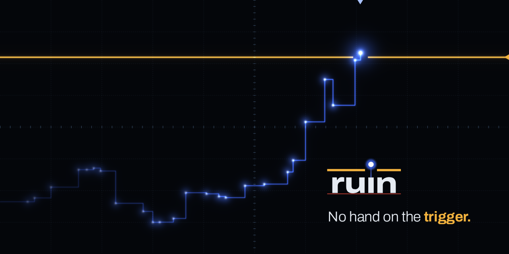

[ruin.live](https://ruin.live) · [X](https://x.com/ruinproblem)

# ruin

Every 1000× bet has a liquidation price. On ruin, the house has one too.

ruin is named after the gambler's ruin, the fifth problem in Huygens' *De Ratiociniis in Ludo Aleae* (1657): two players stake what they have on one walk, and whoever runs out first is ruined. Here a trader stakes one division, a house stakes k of them (1 to 100), and the walk is the DOVES price. Both stakes go into one Solana contract at the fill. Whichever line the price reaches first ends the bet and settles it from that contract; a stop splits it along a straight line fixed before the bet. k sets the largest win: 9.3 times the margin at k = 10 and 93 times at k = 100, with a 7% edge. What either side can win is in the contract from the moment it fills.

Program: `Ho2q71TyPF3ywjq5mwm8PoPZBT2bVk5jJsKWsrffeamw`.

## Accounts

| Account | Seeds | Purpose |
|---|---|---|
| Config | `config` | Admin, quote mint, optional RUIN mint, oracle accounts, and parameters |
| House | `house`, u64 LE ID | Owner, stake, copied terms, sequence, and accepting/busy state |
| Quote vault | `house_vault`, house address | Settlement tokens controlled by the house PDA |
| Lock vault | `lock_vault`, house address | RUIN held until a withdrawal or house close permits its return |
| Table | `table`, house address, u64 LE sequence | Request, fill price, trader terms, and close request |

## Calls and events

| Call | Authority | Event |
|---|---|---|
| `init` | Deployment upgrade authority | Initialized |
| `set_params`, `set_ruin`, `set_feed` | Config admin | ParamsSet, RuinSet, FeedSet |
| `post_house` | House owner | HousePosted |
| `top_up`, `withdraw` | House owner; idle house | HouseFunded |
| `set_accepting` | House owner | HouseAccepting |
| `close_house` | House owner; idle house | HouseClosed |
| `request_open` | Trader | OpenRequested |
| `fill_open` | Anyone | Opened |
| `request_close` | Trader | CloseRequested |
| `settle` | Anyone | Settled |
| `refund_open` | Anyone | OpenRefunded |

A house takes one table at a time. For margin `m` and house multiple `k`, the table holds `(1+k)m`: `m` from the trader and `km` from the house. Settlement transfers the trader's share and leaves the remainder in the house; closing or refunding a table returns its account rent to the trader.

## Split and delays

At a fill price `p0`, leverage `L` and current price `p`, let `y = 1 + side × L × (p-p0)/p0`, with `side` +1 for long and −1 for short. The split fraction is `clamp(y, 0, 1+k)/(1+k)`. The trader receives this fraction of `m × (1+k × (1-e))`, rounded down using integer arithmetic. The house receives the rest of `(1+k)m`. `e` is the house edge as a fraction. At `y <= 0` the trader's line ends the table; at `y >= 1+k` the house's line ends it.

A request uses its request slot's SlotHashes hash to select an inclusive delay between `delay_min` and `delay_max`. Its fill must land from the target through target + `fill_window`, and use a newer, fresh oracle publication. After the request slot + `delay_max` + `fill_window`, anyone can refund an unfilled request. A stop has the same delayed selection and a `close_window`; it needs an oracle publication newer than the close request's publication. A missed stop window permits another stop request. A line takes precedence over a stop, and a stop over expiry. Once `expiry_secs` has passed since fill, anyone can settle with the fresh current value.

Default mainnet preparation values are leverage 500–1000, k 1–100, edge 0–10%, expiry 259,200 seconds (72 hours), minimum margin 1,000,000 raw USDC ($1), free stake 100,000,000 raw USDC ($100), delay 10–23 slots, fill/close windows 4 slots, and maximum oracle age 30 seconds. Delay is measured again before initialization. Slot time varies; slots govern the windows.

## Configuration and authority

The quote mint is classic Token USDC, `EPjFWdd5AufqSSqeM2qN1xzybapC8G4wEGGkZwyTDt1v`, with six decimals. Initialization fixes the quote mint, admin, leverage/k/edge ranges and expiry. The admin can change minimum margin, free stake, RUIN per dollar, delays, windows and maximum oracle age. Houses copy free stake and RUIN per dollar at creation. Tables copy their terms and timing at request. A changed feed address affects later oracle reads for existing tables; the asset must remain the same.

The admin may set RUIN once. Until a mint and nonzero rate are set, a house cannot exceed the free stake threshold. Above that threshold, required lock is `ceil(stake_raw × ruin_per_usd / 1,000,000)`; it applies to the whole stake. A lower stake can release surplus locked RUIN. Classic Token and Token-2022 mints are supported. Active transfer hooks, transfer-fee mints and frozen default account state are rejected. Mint decimals and extension support must be checked before using a token.

The deployment upgrade authority can replace the program. The Config admin cannot transfer vault funds or replace the upgrade authority through these calls. Admin changes do not rewrite copied house/table terms. Inspect both authorities and the current deployed binary before relying on these rules.

## Oracle accounts

Owner program: `DoVEsk76QybCEHQGzkvYPWLQu9gzNoZZZt3TPiL597e`.

| Market | Price account | Asset mint |
|---|---|---|
| SOL | `FYq2BWQ1V5P1WFBqr3qB2Kb5yHVvSv7upzKodgQE5zXh` | `So11111111111111111111111111111111111111112` |
| BTC | `hUqAT1KQ7eW1i6Csp9CXYtpPfSAvi835V7wKi5fRfmC` | `3NZ9JMVBmGAqocybic2c7LQCJScmgsAZ6vQqTDzcqmJh` |
| ETH | `AFZnHPzy4mvVCffrVwhewHbFc93uTHvDSFrVH7GtfXF1` | `7vfCXTUXx5WJV5JADk17DUJ4ksgau7utNKj4b963voxs` |

A price account has 394 bytes. The program checks its discriminator, owner, asset at byte 8, and exponent −8 at byte 176. It reads the u64 little-endian price at byte 168 (eight decimals) and i64 publication timestamp at byte 177. DOVES terms are not published. Missing an intermediate value can affect an off-chain keeper's ability to land a line settlement; the program settles the value present when the call executes.

## Run a keeper

Use Node 26.11.1. From `keeper/`, run `npm ci`, `npm run typecheck`, and `npm test`. Set `RUIN_CLUSTER=mainnet` and `KEEPER_ALLOW_MAINNET=1`, set `KEEPER_KEYPAIR` to a funded signer's file outside the source tree, then run `NO_DNA=1 npm run keeper`. Keep the signer file private. `RPC_URL_FALLBACK`, `RPC_URL_FALLBACK_2` and `RPC_URL_FALLBACK_3` are optional server-only alternatives. HTTP and WebSocket connections try `public`, `fallback`, `fallback2`, then `fallback3`; alternatives must return the expected genesis hash. `RUIN_WS_URL` can override the public WebSocket address.

Anyone may call fill, settle or refund using the generated TypeScript client in `program/client/`. Running this keeper is optional; those calls do not grant custody over a house or trader. Keeper fees and account creation require SOL in the caller's wallet. An unavailable keeper delays settlement; an unfilled request remains refundable after its window.

The shared-data process is `NO_DNA=1 npm run tape` with `RUIN_CLUSTER=mainnet` and a persistent `TAPE_DATA_DIR`. It records confirmed DOVES update transactions and ruin receipts in SQLite, collects the public YOLO trade stream, and publishes JSON on 127.0.0.1:8788. The deploy directory contains service and tunnel templates. A wallet sends website transactions through its own connection; shared-data files do not accept transaction broadcasts.

## Build and verify

Use Agave 3.1.10, Anchor 1.1.2 and solana-verify 0.5.2. From `program/`, `npm ci`, `NO_DNA=1 npm run build`, `npm run typecheck`, and `npm test`. The test fixtures contain public-chain accounts and token program binaries for offline LiteSVM tests. The build produces the mainnet binary at `target/mainnet/ruin.so` and a separate devnet-feature binary; the latter adds test-feed support and is not the mainnet binary.

The workflow builds the default-feature library with `solana-verify build --library-name ruin`, then publishes `ruin.so` and its hash as artifacts. Verification uses this source commit and library name:

```sh
NO_DNA=1 solana-verify verify-from-repo --skip-build --program-id Ho2q71TyPF3ywjq5mwm8PoPZBT2bVk5jJsKWsrffeamw --library-name ruin --mount-path program --commit-hash <source-commit> https://github.com/ruinproblem/ruin
```

With `--skip-build`, this command uploads verification metadata only. It does not build or compare the program. Use the exact workflow artifact for deployment, compare its executable hash with the deployed program, and request remote verification before reporting a verified deployment. A passing source test suite does not establish that any particular deployment matches it.
